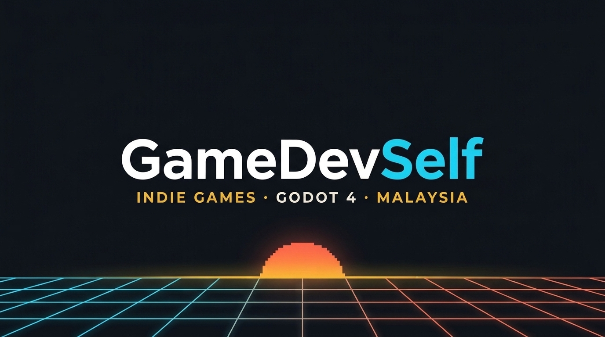

  

Indie game studio and game jam lab under **DevSelf**, building chaotic, Malaysian-flavoured games in **Godot 4**.

## Games

| Game | Details |
| :---: | :--- |
|  | **[Warung Kalut](https://github.com/GameDevSelf/WarungKalut)** Co-op Malaysian street-food cooking game featuring Roti Jala, Karipap, Nasi Lemak, and Teh Tarik. `Godot 4.7` · `GDScript` · `Xsolla Game Jam` |
|  | **[Anti-Kepam](https://github.com/GameDevSelf/Anti-Kepam)** Vice City sunset cel-shaded hygiene rush game in English &amp; Bahasa Melayu. `Godot 4.7` · `GDScript` · `Xsolla Game Jam` · `GamePix` |
| 🌙 | **[Bloody Nights](https://github.com/GameDevSelf/Bloody-Nights-)** Upcoming indie game project *(in development)*. |

## Tech Stack

| Layer | Tools |
| :--- | :--- |
| **Engine** | Godot 4.7 (GL Compatibility renderer) |
| **Languages** | GDScript, GDShader |
| **Targets** | Web / HTML5 (GamePix SDK), Linux, Windows |

## Studio & Links

- Maintainer: [@idrisharis12](https://github.com/idrisharis12)
- Sibling Org: [devselves](https://github.com/devselves)
